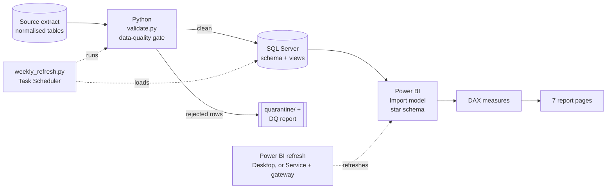
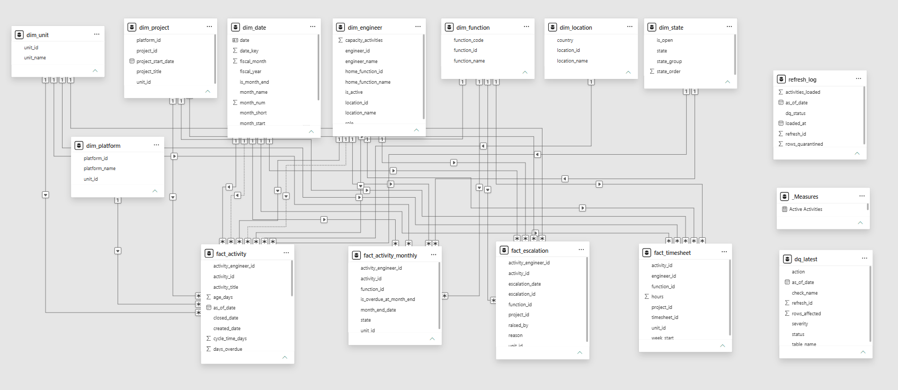
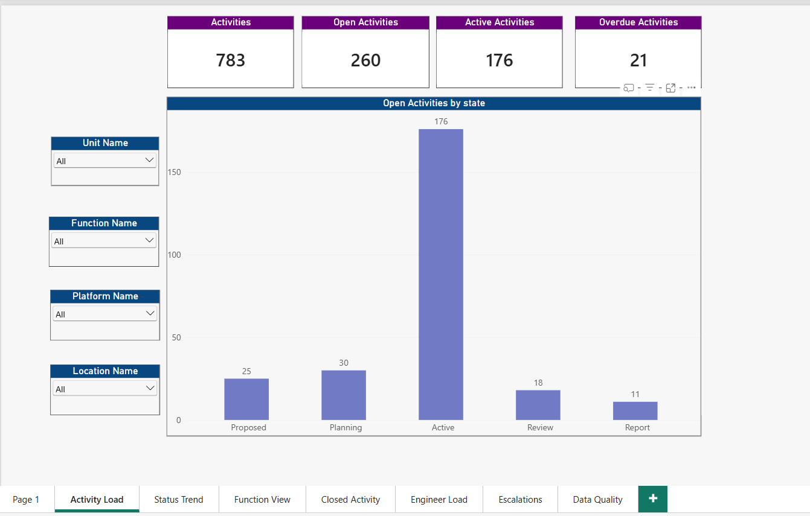
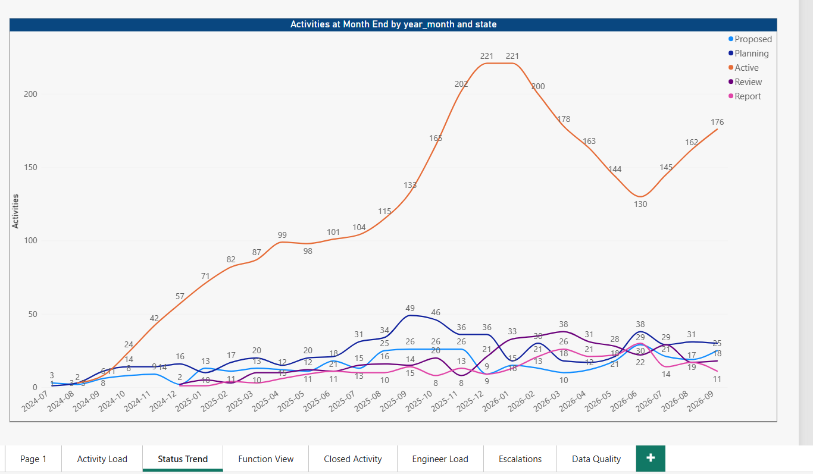
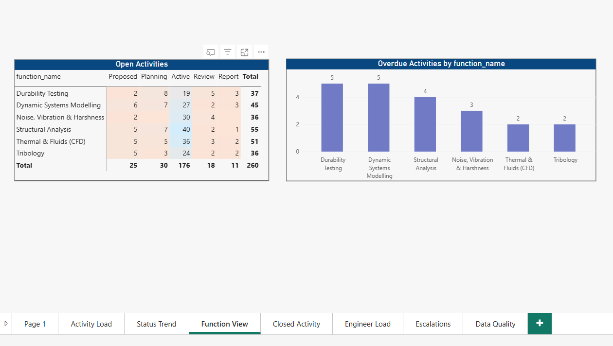
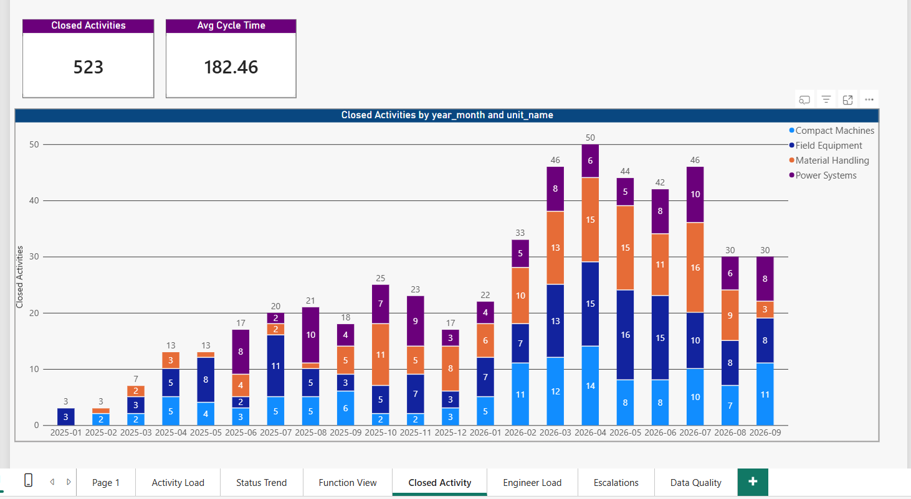
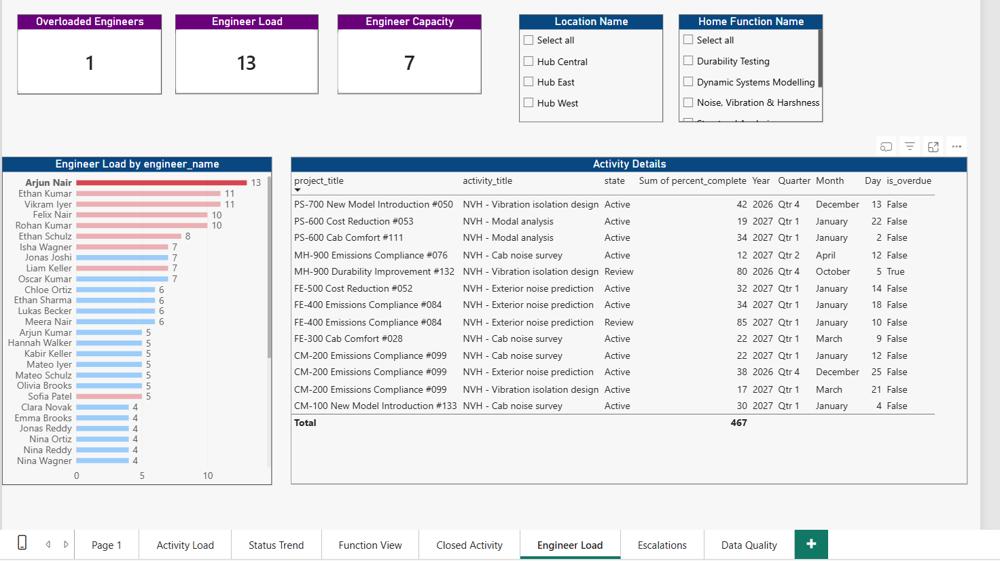
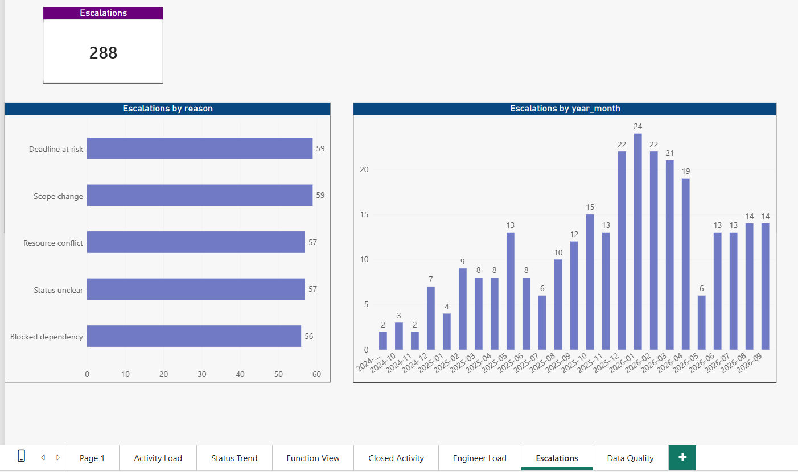
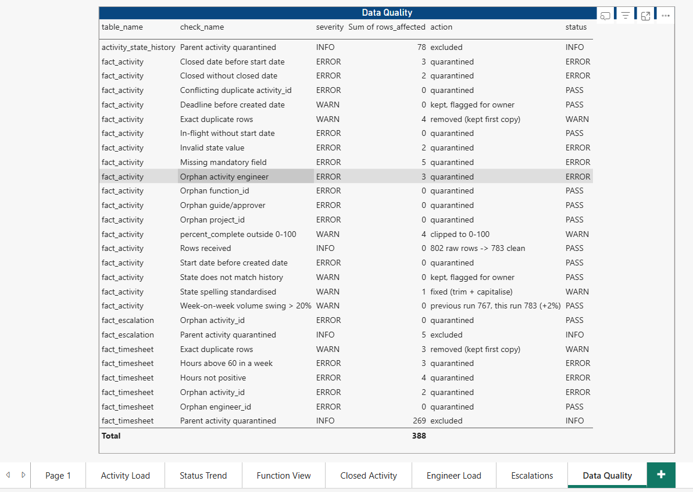

# Engineering Activity Analytics

**SQL Server · Python (Pandas) · Power BI · DAX** — an end-to-end reporting solution that gives engineering managers one current view of activity status, completion and engineer workload across a portfolio of 140 concurrent projects, refreshed automatically every week.

> **About this project.** This is a portfolio project, built to demonstrate the skills I used in a previous role delivering engineering resource and activity reporting: SQL on a normalised source, Power BI data modelling and DAX, workload analysis with cross-filtering, and an automated weekly reporting cycle. **All data is synthetic**, generated by `data/generate_data.py`. Every name, unit, project and number is fictional. It is not a copy of any employer's system, data or reports.

---

## The business problem

An engineering organisation runs 100+ projects at a time. Each project is split into activities, and each activity belongs to one engineering discipline (structural, thermal, NVH and so on), one engineer and one product unit. The data sits in a normalised tracking system, so routine questions need several joins:

- How many activities are in each state right now, by unit, function and location?
- How has the status mix changed month by month?
- How many activities closed this month, and how long do they take?
- **Which engineers are overloaded, who has spare capacity, and which activities make up each person's load?**

Without a reporting layer, someone rebuilds the answers by hand every week before the planning meeting.

## The solution



| Layer | What it does | Files |
|---|---|---|
| Source | 12-table synthetic extract: units, platforms, functions, engineers, projects, activities, state history, timesheets, escalations | `data/generate_data.py` |
| Data quality | 20+ checks: duplicates, missing keys, invalid states, orphan foreign keys, impossible dates, reconciliation, week-on-week volume. Bad rows are quarantined with a reason; a circuit breaker stops the load if more than 5% fail | `pipeline/validate.py` |
| Storage | Normalised SQL Server schema with primary keys, foreign keys and check constraints | `sql/01_schema.sql` |
| Transformation | Multi-table joins, business rules (open, in-flight, overdue), a month-end snapshot rebuilt from state history, engineer load with window functions | `sql/03_views.sql` |
| Model | Star schema: 4 fact tables, 8 dimensions, role-playing date and engineer relationships | `docs/data_model.md` |
| Calculations | 14 DAX measures in the report: status counts, a month-end snapshot, closures and guide work via `USERELATIONSHIP`, load vs capacity. `dax/measures.dax` holds a wider library (time intelligence, rates) | `dax/measures.dax` |
| Automation | Weekly extract → validate → load in one transaction, with logging and exit codes, scheduled with Windows Task Scheduler; every load recorded in `etl_refresh_log` | `pipeline/weekly_refresh.py`, `docs/automation.md` |

## Report pages

**Data model:** star schema with 4 fact tables and 8 dimensions; dotted lines are the two inactive relationships (closed date, guide/approver).



### 1. Activity Load: how many activities are in each state right now, and where?


### 2. Status Trend: how has the status mix changed month by month?
Month-end snapshot rebuilt from state history; the measure takes the last snapshot in view, so a year shows its year-end position.


### 3. Function View: where is the work concentrated by discipline?


### 4. Closed Activity: how much is completed per unit and month, and how fast?
Closures are dated by `closed_date` through an inactive relationship switched on with `USERELATIONSHIP`.


### 5. Engineer Load: who is overloaded, and which activities make up each person's load?
Click an engineer and the table lists exactly the activities behind their load (cross-filtering). Guide/approver work is shown separately and not counted as load.


### 6. Escalations: how many, when, and why?


### 7. Data Quality: did this week's data pass its checks?


## Design decisions

- **The activity is the grain.** One row in `fact_activity` is one engineering activity, and every headline number is `DISTINCTCOUNT(activity_id)`. Projects give context; a project spans several functions, so counting projects by function would double count.
- **Business rules live in one place.** "Open", "in-flight" and "overdue" are defined once in a SQL view, so SQL reconciliation queries and the dashboards always agree.
- **History from state changes, not stored snapshots.** The month-end trend is rebuilt from `activity_state_history` with a range join (`valid_from <= month_end < valid_to`), so any past month can be reproduced.
- **Engineer load = in-flight activities vs capacity.** Only Active, Review and Report count. The guide/approver role is shown separately (inactive relationship + `USERELATIONSHIP`) and does not inflate anyone's load.
- **Fix what is unambiguous, reject what is not.** A state of `closed ` (wrong case, trailing space) can only mean `Closed`, so it is standardised and logged; `In Progress` could mean Active or Review, so it is quarantined rather than guessed.
- **Import mode.** Weekly data, a small model and heavy cross-filtering: interactivity matters more than real-time freshness.
- **Validate before load.** A bad extract never reaches the dashboard; last week's data stays in place.

## Data quality checks

| Check | Example caught in the sample extract | Action |
|---|---|---|
| Exact duplicate rows | 4 activity rows sent twice | Remove copy |
| Missing mandatory field | 5 activities with no engineer | Quarantine |
| State spelling | `closed ` (case, trailing space) | Standardise to `Closed`, log |
| Invalid state | `Actve`, `In Progress` | Quarantine |
| Orphan foreign key | Engineer `E999` does not exist | Quarantine |
| Impossible dates | Closed before it started | Quarantine |
| State/date mismatch | Closed with no closed date | Quarantine |
| Out-of-range value | `percent_complete` = 110 | Clip to 0–100 |
| Timesheet validity | Negative hours, 99 hours in a week | Quarantine |
| Reconciliation | Current state vs state history | Flag |
| Volume swing | Clean rows change > 20% week on week | Warn |

Every run writes `reports/dq_report_<as_of>.md`. A sample is included in the repo.

## Repository structure

```
engineering-activity-analytics/
├── data/
│   ├── generate_data.py        synthetic source extract (seeded, reproducible)
│   ├── make_edl_files.py       writes the raw extract as data-lake files
│   ├── edl_source/             raw 'EDL' tables for the quick path
│   ├── raw/                    extract as received, with injected defects
│   ├── processed/              validated, load-ready tables
│   └── quarantine/             rejected rows + reason
├── pipeline/
│   ├── validate.py             data-quality gate
│   └── weekly_refresh.py       extract -> validate -> load, scheduled weekly
├── sql/
│   ├── 01_schema.sql           tables, keys, constraints
│   ├── 02_load.sql             manual BULK INSERT load (alternative to --load)
│   ├── 03_views.sql            reporting views (joins, rules, snapshot, window functions)
│   ├── 04_analysis_queries.sql ad-hoc analysis and reconciliation queries
│   └── quick_build/            one-script EDL -> rpt build for the quick path
├── dax/
│   └── measures.dax            all DAX measures, grouped by page
├── docs/
│   ├── data_model.md           ER diagram, star schema, data dictionary, business rules
│   ├── powerbi_build_guide.md  step-by-step Power BI Desktop build
│   ├── automation.md           scheduling, exit codes, design choices
│   ├── quick_build_2hr.md      2-hour EDL -> SQL -> Power BI build
│   └── images/                 report screenshots
├── powerbi/                    engineering_activity_analytics.pbix
├── reports/                    data-quality reports
├── tests/test_validate.py      pytest tests for the DQ gate
└── requirements.txt
```

## How to run

**Quick path (about 2 hours, SSMS + Power BI only):** follow [`docs/quick_build_2hr.md`](docs/quick_build_2hr.md). It loads raw "data lake" files (`data/edl_source/`) into an `edl` schema, runs one SQL script that checks, cleans and joins them into `rpt` views, and builds the five dashboards plus a data-quality page.

**Full path (Python data-quality gate + scheduled load):**

**Prerequisites:** Python 3.10+, SQL Server 2019+ (Developer or Express edition, free) with SSMS, Power BI Desktop. For `--load`: Microsoft ODBC Driver 17 or 18 for SQL Server.

```bash
git clone https://github.com/avinashd144/engineering-activity-analytics.git
cd engineering-activity-analytics
pip install -r requirements.txt

# 1. generate the source extract and run the data-quality gate
python pipeline/weekly_refresh.py --as-of 2026-09-30

# 2. create the database (in SSMS): run sql/01_schema.sql

# 3. load SQL Server, either:
#    a) set EAA_SQL_CONN (see docs/automation.md) and run
python pipeline/weekly_refresh.py --as-of 2026-09-30 --load
#    b) or edit @path in sql/02_load.sql and run it in SSMS

# 4. create the reporting views: run sql/03_views.sql
# 5. check the numbers: run sql/04_analysis_queries.sql
# 6. build the report: follow docs/powerbi_build_guide.md

# tests
pytest -q
```

Simulate the following week's run with `python pipeline/weekly_refresh.py --as-of 2026-10-07 --load`, then refresh Power BI.

## Skills demonstrated

- **SQL (T-SQL):** normalised schema design, multi-table joins, CTEs, window functions (`ROW_NUMBER`, `DENSE_RANK`, `LAG`, running totals, moving averages), range joins for point-in-time snapshots, anti-joins, reconciliation queries
- **Python (Pandas):** synthetic data generation, data validation, quarantine and audit trail, transactional load with `pyodbc`, logging, tests with `pytest`
- **Power BI:** star-schema modelling, role-playing dimensions (inactive relationships), Import mode, date table, sort-by columns, slicers, cross-filtering with edit interactions, conditional formatting
- **DAX:** `CALCULATE` and filter context, `DISTINCTCOUNT`, `USERELATIONSHIP`, snapshot (semi-additive) measures, `DIVIDE`, iterator-based counts (`COUNTROWS(FILTER(VALUES(...)))`); time intelligence in `dax/measures.dax`
- **Automation and governance:** Windows Task Scheduler, logged runs with exit codes, refresh audit table, validation rules, circuit breaker, documented business rules, data dictionary

## Author

Avinash Desai · [GitHub](https://github.com/avinashd144)
