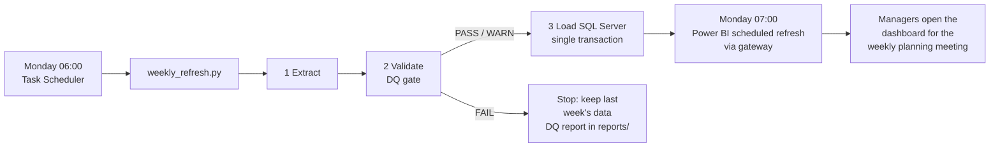

# Weekly automation

## What runs, and when



**Before** (the process this project replaces): someone exported data each week, cleaned it by hand in Excel, rebuilt the charts and circulated them before the planning meeting.
**After:** the extract, checks, load and refresh run unattended. The only human step is reading the DQ report when its status is WARN or FAIL.

## Schedule it on Windows (Task Scheduler)

1. Set the connection string once, as a user environment variable:
   ```
   setx EAA_SQL_CONN "Driver={ODBC Driver 18 for SQL Server};Server=localhost;Database=EngineeringActivity;Trusted_Connection=yes;TrustServerCertificate=yes"
   ```
2. Create the task in PowerShell (adjust the paths). The settings line matters on a laptop: by default Windows only starts a task on mains power, so on battery it sits in "Queued" and never runs.
   ```powershell
   $action   = New-ScheduledTaskAction -Execute "C:\Path\To\python.exe" -Argument '"C:\repos\engineering-activity-analytics\pipeline\weekly_refresh.py" --load' -WorkingDirectory "C:\repos\engineering-activity-analytics"
   $trigger  = New-ScheduledTaskTrigger -Weekly -DaysOfWeek Monday -At 6am
   $settings = New-ScheduledTaskSettingsSet -AllowStartIfOnBatteries -DontStopIfGoingOnBatteries -StartWhenAvailable
   Register-ScheduledTask -TaskName "EAA Weekly Refresh" -Action $action -Trigger $trigger -Settings $settings -Description "Extract, validate, load"
   ```
3. Test it now:
   ```powershell
   Start-ScheduledTask -TaskName "EAA Weekly Refresh"
   Get-ScheduledTaskInfo -TaskName "EAA Weekly Refresh" | Select-Object LastRunTime, LastTaskResult
   Get-Content logs\weekly_refresh.log -Tail 3
   ```
   Success = state `Ready`, `LastTaskResult` 0, and the log ending with `committed (refresh_id N)`. Every load is also recorded in `dbo.etl_refresh_log`.

On macOS/Linux, the cron equivalent is `0 6 * * 1 cd /path/to/repo && python3 pipeline/weekly_refresh.py --load`.

## Exit codes (for monitoring)

| Code | Meaning | What to do |
|---|---|---|
| 0 | Loaded (status PASS or WARN) | Nothing. Read the DQ report if WARN. |
| 1 | Validation FAIL: too many rejected rows | Dashboards still show last week. Check `data/quarantine/`, fix the source, re-run. |
| 2 | Extract unusable (missing table/columns) | Check the source extract. |
| 3 | `--load` used without `EAA_SQL_CONN` | Set the variable. |

## Design choices

- **Validate before load, not after.** A bad extract is stopped before it reaches the dashboards (circuit breaker at 5% rejected activities).
- **Quarantine, don't silently drop.** Every rejected row is kept with the reason, so the data owner can fix it at source.
- **Fix only what is unambiguous.** `percent_complete` of 110 is clipped to 100; a missing engineer is not guessed.
- **Load in one transaction.** Either the whole week loads, or SQL Server keeps last week's data.
- **Power BI refreshes after the load.** The refresh is scheduled an hour later in the Power BI Service. In a production setup, the pipeline could trigger it through the Power BI REST API instead.
