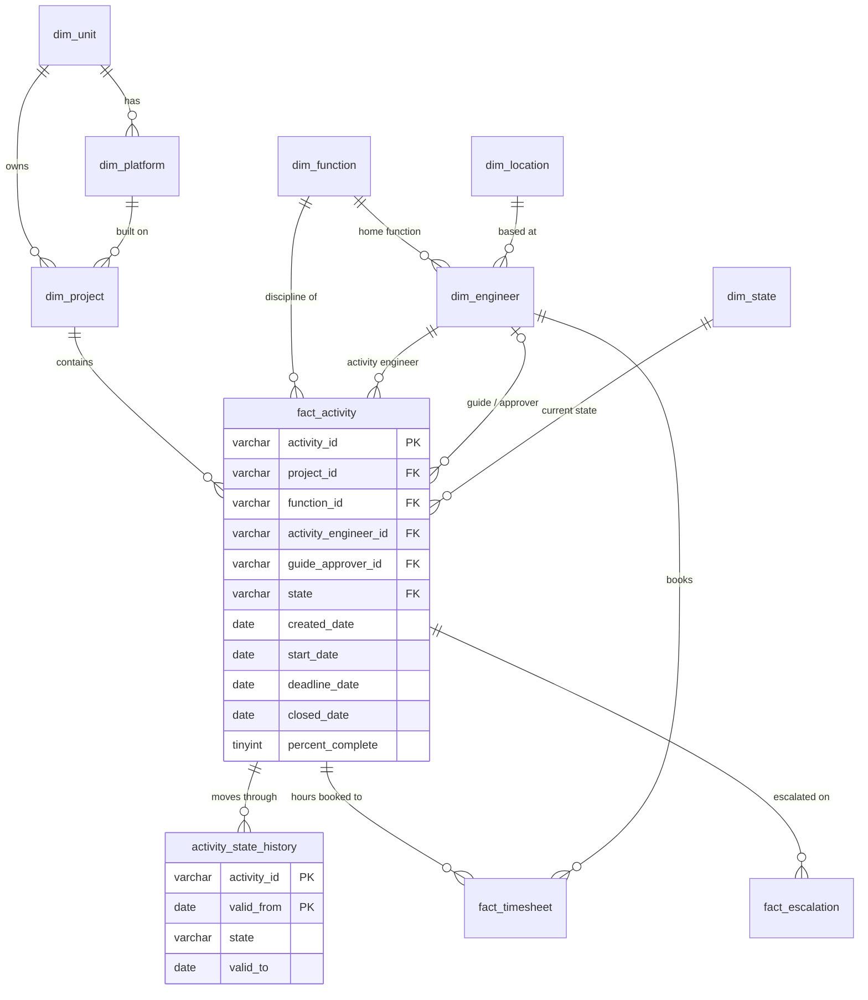
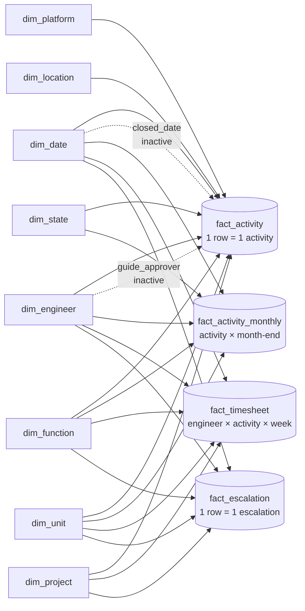

# Data model

Two layers: a normalised **source schema** in SQL Server (what the tracking system holds) and a **star schema** in Power BI (what the reports use). The SQL views in `sql/03_views.sql` turn the first into the second.

## 1. Source schema (SQL Server)

**Hierarchy:** Unit → Project → Activity. Each activity belongs to exactly one engineering function, so one project can span several functions.

**Grain decision:** the activity is the unit of analysis. Status, load and closure counts are all distinct counts of `activity_id`. Project information gives management context around the activities.

## 2. Power BI star schema

All relationships are one-to-many, single direction, dimension → fact. There are no fact-to-fact relationships: each fact view already carries the dimension keys it needs (unit, function, engineer), so every slicer filters every page consistently.

| From (one side) | To (many side) | Active | Why |
|---|---|---|---|
| `dim_date[date]` | `fact_activity[created_date]` | Yes | intake / age analysis |
| `dim_date[date]` | `fact_activity[closed_date]` | **No** | closures, switched on with `USERELATIONSHIP` |
| `dim_date[date]` | `fact_activity_monthly[month_end_date]` | Yes | status trend |
| `dim_date[date]` | `fact_timesheet[week_start]` | Yes | hours |
| `dim_date[date]` | `fact_escalation[escalation_date]` | Yes | escalations |
| `dim_engineer[engineer_id]` | `fact_activity[activity_engineer_id]` | Yes | engineer load |
| `dim_engineer[engineer_id]` | `fact_activity[guide_approver_id]` | **No** | guide/approver view, `USERELATIONSHIP` |
| `dim_engineer[engineer_id]` | `fact_activity_monthly / fact_timesheet / fact_escalation` | Yes | |
| `dim_state[state]` | `fact_activity`, `fact_activity_monthly` | Yes | |
| `dim_function`, `dim_unit` | all four facts | Yes | |
| `dim_project` | `fact_activity`, `fact_timesheet`, `fact_escalation` | Yes | |
| `dim_platform`, `dim_location` | `fact_activity` | Yes | |

`refresh_log` and `dq_latest` stand alone (no relationships). They feed the "data as of" label and the Data Quality page.

## 3. Data dictionary

### fact_activity (from `vw_fact_activity`)
| Column | Type | Description |
|---|---|---|
| activity_id | text | Unique activity identifier (key) |
| project_id, unit_id, platform_id | text | Project and its unit/platform |
| function_id | text | Engineering discipline of the activity |
| activity_engineer_id | text | Engineer doing the work (counts towards load) |
| guide_approver_id | text | Senior/lead who guides or approves (does not count towards load) |
| location_id | text | Location of the activity engineer |
| state | text | Proposed, Planning, Active, Review, Report, Closed |
| created_date / start_date / report_date / closed_date | date | Date raised / entered Active / entered Report / closed |
| deadline_date | date | Planned completion date |
| percent_complete | whole number | 0–100 |
| planned_hours | whole number | Planned effort |
| is_open | true/false | State is not Closed |
| is_in_flight | true/false | Active, Review or Report — counts towards engineer load |
| is_overdue | true/false | Open and past deadline at the as-of date |
| days_overdue, age_days, cycle_time_days | whole number | Derived durations |

### fact_activity_monthly (from `vw_fact_activity_monthly`)
One row per activity per month-end it existed, with the state it was in on that day. Rebuilt from `activity_state_history` with a range join (`valid_from <= month_end < valid_to`).

### fact_timesheet, fact_escalation
Weekly hours per engineer per activity; one row per escalation with reason and who raised it.

### dim_engineer (from `vw_dim_engineer`)
Engineer name, role, home function, location and `capacity_activities` (how many in-flight activities one person can reasonably carry; Engineer 6, Senior 7, Lead 4).

### dim_date
Daily calendar with month, `is_month_end`, April–March `fiscal_year` and `fiscal_month`, and `week_start` (Monday).

## 4. Business rules

| Rule | Definition | Lives in |
|---|---|---|
| Open | `state <> 'Closed'` | `dim_state.is_open` |
| In-flight (engineer load) | `state IN ('Active','Review','Report')` | `vw_fact_activity.is_in_flight` |
| Overdue | open and `deadline_date < as-of date` | `vw_fact_activity.is_overdue` |
| Load ratio | in-flight activities ÷ capacity | DAX `[Load Ratio]`, SQL `vw_engineer_load` |
| Load band | > 1.0 Overloaded, < 0.5 Under-utilised, else Balanced | DAX `[Load Band]`, SQL `vw_engineer_load` |
| Escalation rate | escalations in month ÷ in-flight at month-end × 100 | DAX, SQL `vw_escalations_monthly` |

Rules are defined once (SQL flags or a single DAX measure) and reused, so the SQL reconciliation queries and the dashboards always agree.
